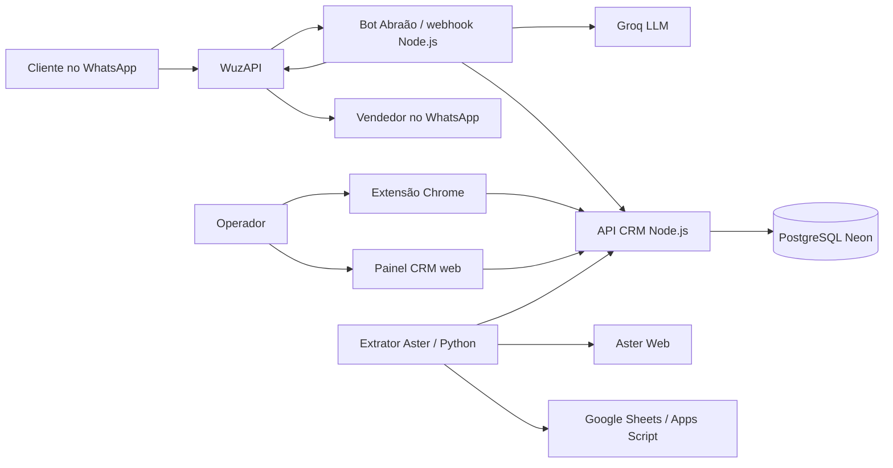

# Arquitetura completa do sistema CRM Grupo ABR

> Documento técnico e funcional do estado verificado em 15 de outubro de 2026. Ele descreve o que existe no repositório e o que está efetivamente em execução. Segredos, senhas e tokens foram deliberadamente omitidos.

## 1. Visão geral

O sistema é uma plataforma própria de atendimento comercial que liga cinco contextos:

1. o WhatsApp oficial do Grupo ABR;
2. o bot Abraão, responsável pela recepção e qualificação inicial;
3. o CRM web e a extensão Chrome usados pelos operadores;
4. o banco PostgreSQL central, que mantém clientes, fichas, funis, transferências, tarefas e vendas;
5. o Aster, usado como fonte diária de faturamento e tonelagem.

O CRM é o núcleo transacional. O bot não mantém um segundo cadastro comercial: quando conclui a qualificação, ele chama a API do CRM, que cria ou associa o cliente, abre a ficha, escolhe o vendedor, cria o protocolo e registra a transferência. A extensão Chrome e o painel web usam a mesma API e o mesmo banco, portanto uma alteração feita em uma interface aparece na outra.

## 2. Organização do repositório

O Git contém o projeto completo, organizado da seguinte forma:

- `crm/`: monorepo JavaScript/TypeScript do CRM e dos bots.
- `crm/apps/api/`: API HTTP, painel CRM e migrations do banco.
- `crm/apps/wuzapi-bot/`: bot Abraão usado no fluxo produtivo por webhook.
- `crm/apps/whatsapp-bot/`: bot alternativo baseado em Chromium/Playwright.
- `crm/packages/domain/`: regras de domínio testáveis, como telefone, roteamento, transferência, deduplicação, segurança da IA e outbox.
- `crm/packages/contracts/`: contratos Zod compartilhados para triagem, observações e capacidades da extensão.
- `extension/`: extensão Chrome efetivamente distribuída aos operadores.
- `crm/apps/extension/`: esqueleto inicial de extensão; não é a interface completa atualmente distribuída.
- `crm/tools/diagnostic-extension/`: ferramenta de diagnóstico que originou parte da extensão operacional.
- `extracao_aster/`: serviço Python independente para extrair o relatório comercial do Aster e sincronizar os resultados.

O projeto `crm` usa npm workspaces. Não há processo de compilação para o painel web: o navegador recebe diretamente um único arquivo HTML com CSS e JavaScript nativos. A extensão também é JavaScript nativo e é carregada no Chrome como Manifest V3.

## 3. Stack tecnológica

| Camada | Tecnologias |
|---|---|
| CRM web | HTML5, CSS3 e JavaScript nativo, sem React/Vue e sem bundler |
| API CRM | Node.js 22, módulos ES, servidor `node:http` nativo |
| Persistência | PostgreSQL hospedado no Neon, driver `pg` e pool de conexões |
| Planilhas | ExcelJS para leitura de XLSX |
| Autenticação | token assinado por HMAC-SHA256 e hashes de senha via `pgcrypto/crypt` |
| Bot produtivo | Node.js, webhook HTTP, WuzAPI e API de chat da Groq |
| Transporte WhatsApp | WuzAPI em contêiner Docker, usando a sessão do WhatsApp |
| Extensão | Chrome Manifest V3, content script, Shadow DOM e `chrome.storage` |
| Bot alternativo | Node.js + Playwright + Chromium persistente |
| Extração Aster | Python 3.12, Flask, Gunicorn, Playwright/Chromium, openpyxl |
| Planilha de metas | Google Sheets integrado por Google Apps Script |
| Validação | Vitest, TypeScript estrito, Zod, JSDOM e PGlite |
| Contêineres | Docker e Docker Compose na VM do WhatsApp; Docker no Render para Aster |
| Proxy HTTPS | Caddy na VM do CRM |
| Versionamento | Git e GitHub |

## 4. CRM web

O painel está em `crm/apps/api/public/crm.html` e é servido pela própria API em `/crm`. Isso evita manter um frontend e um backend em hospedagens diferentes.

### 4.1 Áreas da interface

- **Funil de vendas:** Kanban por funil e etapa. Os cards podem ser arrastados, abertos, editados e apagados por exclusão lógica.
- **Atendimento:** indicadores de atendimentos, ganhos, perdidos, encaminhados, assumidos e follow-ups. O escopo é calculado no servidor.
- **Clientes:** tabela consultada somente após pesquisa ou aplicação de filtros. Permite filtrar por texto, segmentação e vendedor, com paginação de 25, 50 ou 100 itens.
- **Vendas:** dois grupos recolhíveis, um para o vendedor e outro para a equipe. Combina vendas ganhas registradas no CRM com o resumo diário recebido do Aster.
- **Equipe e rotas:** área administrativa para usuários, funções comerciais, WhatsApp e rotas. O menu é visível apenas para administrador.
- **Meu perfil:** dados do operador, função comercial, WhatsApp e rota principal.
- **Ficha lateral:** edição do cliente, empresa, cidade, UF, segmento, necessidade, potencial, temperatura, valor, número do pedido, tarefas, notas, transferência e fechamento.

### 4.2 Regras do ciclo comercial

- Uma ficha acompanha o cliente entre funis e etapas; não é necessário duplicar o cliente.
- A venda só pode ser marcada como ganha quando há valor positivo e número do pedido.
- Uma venda perdida é deslocada automaticamente para o funil de reativação.
- Apagar um card preenche `deleted_at`; a exclusão é lógica e o registro deixa de aparecer nos relatórios ativos.
- Registrar contato atualiza a referência de reativação e programa a próxima ação.
- O CRM exporta as fichas em CSV.

### 4.3 Escopo dos indicadores de atendimento

O filtro não depende apenas da interface; ele é aplicado nas consultas SQL:

- vendedor ou usuário comum: somente fichas cujo responsável é o próprio usuário;
- vendedor externo: suas fichas e as dos vendedores não externos que compartilham seu canal e polo/rota;
- supervisor e administrador: todos os atendimentos da organização.

## 5. API CRM

O backend está em `crm/apps/api/src/server.mjs`. É um servidor HTTP monolítico leve, sem Express ou Fastify. Ele executa na porta 10000 e concentra autenticação, regras de negócio, acesso ao banco e entrega do HTML.

### 5.1 Módulos internos

- `server.mjs`: roteamento HTTP, autenticação, CORS, arquivos estáticos, integração Groq e validação dos corpos.
- `storage.mjs`: implementação PostgreSQL e uma implementação em memória para testes locais.
- `ai-triage.mjs`: prompt, validação e guarda da triagem supervisionada.
- `ai-vision.mjs`: validação de imagens para teste de leitura visual.
- `customer-import.mjs`: interpretação das planilhas de clientes inativos e produção.
- `customer-lifecycle.mjs`: cálculo de reativação.
- `handoff-link.mjs`: criação do link `wa.me` personalizado.
- `migrate.mjs`: executor transacional e versionado das migrations.

### 5.2 Principais grupos de endpoints

- autenticação e perfil: `/v1/auth/login`, `/v1/auth/me`, `/v1/profile`;
- clientes e fichas: `/v1/customers`, `/v1/customers/table`, `/v1/cases`;
- funis: `/v1/funnels`, `/v1/funnels/:id/board`, alteração de etapa;
- equipe e roteamento: `/v1/sellers`, `/v1/routing/simulate`;
- tarefas, notas e contatos: endpoints vinculados à ficha;
- transferência: criação, fila, consulta e aceite de handoffs;
- outbox: criação e confirmação de comandos de envio;
- relatórios: KPIs, vendas e CSV;
- importação XLSX: prévia temporária e confirmação;
- integração Aster: `/v1/integrations/aster/daily`;
- IA: triagem, smoke test e leitura visual;
- operação: `/healthz` e `/readyz`.

### 5.3 Protocolos e links

Cada transferência recebe um protocolo aleatório no formato `ABR-XXXX-XXXX`. O protocolo identifica a operação, mas não funciona como credencial. A mensagem enviada ao vendedor contém responsável, protocolo, cliente, telefone, código CRM, cidade/UF, necessidade, link para chamar o cliente e link direto da ficha no CRM.

## 6. Banco de dados

O banco central é PostgreSQL no Neon. A aplicação usa a URL pooled para tráfego normal; migrations devem usar a URL direta. As migrations são incrementais e registradas em `schema_migrations`.

### 6.1 Domínios de dados

- **Identidade:** organizações, usuários, departamentos e vínculos.
- **WhatsApp e dispositivos:** contas, associação com operador, dispositivos e leases.
- **Clientes:** contatos, telefones E.164, código ABR e chaves externas.
- **Catálogos:** municípios, regiões, segmentos, canais, origens e motivos de perda.
- **CRM:** fichas, funis, etapas, histórico de etapa, notas e tarefas.
- **Roteamento:** perfis comerciais, rotas, regras versionadas, atribuições e carteiras.
- **Transferência:** handoffs, eventos do handoff e outbox.
- **Observação:** conversas e mensagens observadas pela extensão.
- **Importação e reativação:** chaves do cadastro externo, resumo de compras e datas de referência.
- **Vendas:** valor, orçamento/pedido, ganho, perda e exclusão lógica.
- **Aster:** fotografias diárias por vendedor, região e segmento.
- **Operação:** jobs, idempotência e auditoria.

Todos os registros de negócio pertencem a uma organização. Datas são armazenadas com timezone e valores monetários usam `numeric`; valor desconhecido permanece `NULL`, não zero.

## 7. Roteamento comercial

O roteamento combina canal, função comercial e localização.

### 7.1 Varejo

O varejo atende o Sul de Minas. A cidade de entrega é convertida para um polo comercial, como Varginha, Pouso Alegre, Poços de Caldas, Itajubá, Extrema, Cambuí, Bragança ou Jundiaí. Andradas, por exemplo, pertence ao polo Varginha.

Dentro do polo, a necessidade é classificada em uma função:

- `especialista`;
- `corporativo`;
- `construcao_civil`;
- `vendedor_externo`;
- `adm_sdr`.

### 7.2 Atacado

Quando a cidade não pertence ao território de varejo do Sul de Minas, o bot direciona a ficha ao canal ATACADO. O backend usa DDD e rotas cadastradas para escolher entre os vendedores externos do atacado. Existem rotas para os DDDs 11 a 19, distribuídas entre Larissa Terra, Julio Melo e Wilson Neto.

### 7.3 Ambiguidade de cidade

O endereço usado é sempre o local de entrega. Se o cliente disser “moro em São Paulo, mas estou construindo em Andradas”, o bot não usa automaticamente São Paulo: ele detecta múltiplas referências ou a diferença entre residência e obra e confirma a cidade/UF de entrega.

### 7.4 Pedido por vendedor específico

O bot consulta os operadores ativos do CRM, faz correspondência pelo nome e usa o WhatsApp cadastrado. Mesmo com pedido explícito, a transferência só ocorre após a qualificação mínima.

## 8. Bot Abraão em produção

O componente produtivo está em `crm/apps/wuzapi-bot/src/server.mjs`. Ele recebe eventos do WuzAPI em `POST /webhook` e expõe `/healthz`.

### 8.1 Fluxo de uma conversa

1. O WuzAPI recebe uma mensagem do WhatsApp e chama o webhook.
2. O bot descarta grupos, mensagens próprias, eventos sem texto e IDs já processados.
3. Se houver lista de números permitidos, números fora dela são ignorados.
4. O bot mantém até 12 mensagens recentes por conversa e extrai nome, cidade, UF, produto e detalhe.
5. Regras determinísticas tratam saudação, portfólio, intenção de compra, orçamento, localização e pedido de humano.
6. Para perguntas livres permitidas, a conversa é enviada à Groq com a persona e os limites comerciais.
7. A saída passa por uma segunda guarda que bloqueia oferta de orçamento, preço, estoque, prazo ou concorrentes.
8. A resposta recebe atraso variável, normalmente entre 3,5 e 7,5 segundos.
9. Se uma nova mensagem chegar durante o atraso, a resposta antiga é descartada e apenas o contexto mais recente é respondido.
10. Após a qualificação obrigatória, o bot cria a ficha no CRM e recebe o vendedor escolhido.
11. O bot confirma se o número do vendedor existe no WhatsApp, envia a prévia e depois confirma ao cliente o vendedor e o protocolo.

### 8.2 Qualificação obrigatória

A ordem lógica é:

1. nome de tratamento;
2. cidade e UF da entrega;
3. produto;
4. ao menos um detalhe útil, como aplicação, medida ou quantidade.

O bot pode explicar o portfólio e tirar dúvidas gerais. Ele não pode elaborar orçamento, informar preço, desconto, estoque, prazo, crédito, condição de pagamento, garantia, disponibilidade ou comparação com concorrentes.

### 8.3 Estado e proteção contra repetição

As conversas, IDs já vistos, respostas pendentes e trava pós-transferência ficam em memória no processo Node. A trava evita nova ficha para a mesma conversa por 12 horas. Como esse estado não está no PostgreSQL ou Redis, ele é perdido se o contêiner reiniciar.

### 8.4 Relação com o arquivo de treinamento

O arquivo `crm/apps/whatsapp-bot/training/abr-bot-training.json` é consumido pelo bot Playwright alternativo. O bot produtivo WuzAPI mantém persona, catálogo, regras de qualificação e proibições diretamente em `apps/wuzapi-bot/src/server.mjs`. Portanto, alterar somente o JSON não muda automaticamente o comportamento do bot produtivo.

## 9. WuzAPI e infraestrutura do WhatsApp

O WhatsApp roda em uma VM Oracle Linux separada. O Docker Compose mantém três contêineres:

- `wuzapi`: gateway do WhatsApp, exposto na porta 8080;
- `wuzapi-db`: PostgreSQL 16 interno do WuzAPI, usado para o estado próprio do gateway;
- `wuzapi-groq-bot`: serviço Node do Abraão, acessível internamente na rede Docker pela porta 3001.

O PostgreSQL do WuzAPI não substitui o Neon e não contém as fichas do CRM. Ele pertence apenas à infraestrutura do gateway WhatsApp.

## 10. Bot Playwright alternativo

`crm/apps/whatsapp-bot` é uma automação alternativa que abre o WhatsApp Web em Chromium usando Playwright. Ela suporta os modos `dry-run`, `supervised` e `auto`, mantém um perfil local persistente e lê o JSON de treinamento.

Esse bot não é o caminho principal da produção atual. Ele é útil para testes locais ou contingência, mas depende de seletores e de uma sessão gráfica do WhatsApp Web, enquanto o fluxo WuzAPI trabalha por API e webhook.

## 11. Extensão Chrome

A extensão operacional está na pasta raiz `extension/`, versão Manifest V3. Ela injeta um content script no WhatsApp Web e usa Shadow DOM para isolar o CSS.

### 11.1 Funcionamento

- Um único botão flutuante permanece na lateral sem cobrir o campo de envio do WhatsApp.
- Ao clicar, abre uma ficha lateral de até 420 px.
- Em telas grandes, o WhatsApp é redimensionado; em telas pequenas, o painel sobrepõe o site.
- A extensão reconhece o chat aberto, pesquisa o cliente e carrega suas fichas.
- Permite criar/editar ficha, alterar funil e etapa, registrar valor e pedido, consultar fila, notas e tarefas.
- O botão Kanban abre o CRM completo em outra aba.
- O token de sessão e as preferências ficam em `chrome.storage`.
- A extensão não armazena chaves administrativas, token do Aster, chave Groq ou credencial do banco.

A API padrão é `https://grupoabr.agenciaverticale.com.br`.

## 12. Integração Aster

O diretório `extracao_aster` contém um serviço Python independente, atualmente na versão V2.

### 12.1 Processo de extração

1. Um navegador Chromium headless entra no Aster com Playwright.
2. O extrator abre o relatório “Resumo Comercial”.
3. Preenche a data de referência e baixa o arquivo.
4. O parser normaliza vendedor, tipo, região, segmento, peso e faturamento.
5. O motor preserva lançamentos manuais e substitui apenas fotografias automáticas da mesma data.
6. O resultado é enviado ao Google Sheets por um Web App do Apps Script.
7. Fora de `dry-run`, o resumo também é enviado à API CRM com token específico.
8. O CRM substitui a fotografia da data e grava uma linha agregada por vendedor em `aster_sales_snapshots`.
9. A aba Vendas combina esses dados com os pedidos ganhos no CRM.

O extrator tenta uma nova autenticação quando o Aster derruba a sessão e salva screenshot/HTML de diagnóstico em caso de falha.

### 12.2 Serviço HTTP

O Flask/Gunicorn expõe:

- `GET /health`: valida se a configuração necessária existe;
- `POST /run`: dispara uma execução autenticada em uma thread;
- `GET /status`: consulta a última execução.

Um lock em memória impede duas execuções simultâneas no mesmo processo.

### 12.3 Agendamento

O `render.yaml` declara um Web Service e um Cron Job. O Web Service está ativo e saudável no Render. O cron diário está descrito no projeto, mas não foi provisionado na conta atual devido ao custo do serviço Cron; por isso a atualização diária depende, neste momento, de disparo externo/manual até a ativação de um agendador.

## 13. Importação de clientes e reativação

Administradores podem enviar `Clientes Inativos.xlsx` e, opcionalmente, `Gestão da Produção.xlsx`.

- A API aceita até 50 MiB.
- Primeiro é criada uma prévia agregada, sem devolver linhas pessoais ao navegador.
- A prévia fica em memória por 30 minutos.
- Telefones, e-mails e códigos externos são usados para deduplicação conservadora.
- Associação por nome só ocorre quando existe uma correspondência única.
- A confirmação grava tudo em uma transação.
- O histórico alimenta última compra, quantidade de pedidos e total comprado.
- O prazo de reativação usa a compra ou o último contato registrado como referência.

## 14. Autenticação, autorização e segurança

### 14.1 Login

- O usuário entra com e-mail ou nome de usuário corporativo.
- A senha é comparada no PostgreSQL com o hash gerado pelo `pgcrypto`.
- A API entrega um token assinado por HMAC-SHA256 com validade de 12 horas.
- O painel pode manter a sessão na aba ou, se solicitado pelo usuário, no armazenamento local.
- A extensão mantém o token no armazenamento privado do Chrome.

### 14.2 Papéis

Os papéis existentes são `admin`, `supervisor`, `sdr`, `seller` e `department_staff`. Algumas rotas têm proteção adicional, como administração de equipe e testes técnicos. O teste de IA e o teste de transferência exigem também um token administrativo separado.

### 14.3 Integrações

- Aster usa um bearer token exclusivo no endpoint de sincronização.
- WuzAPI usa seu token de usuário.
- Groq usa uma chave somente nos serviços backend.
- Banco e migrations usam URLs guardadas em variáveis de ambiente.
- Nenhum segredo deve entrar no Git, na extensão ou no HTML público.

### 14.4 Limitações de segurança atuais

- O CORS da API ainda permite origem `*`; a proteção efetiva depende do bearer token.
- Não existe refresh token, revogação individual de sessão nem fluxo próprio de troca/recuperação de senha.
- A migration inicial contém uma senha provisória compartilhada e ela deve ser trocada por usuário.
- O logout do navegador remove o token local, mas não invalida antecipadamente um token já emitido.
- O estado volátil do bot não sobrevive a reinícios.
- Ainda não há cofre central de segredos, SSO, MFA ou trilha completa de ações do frontend.

## 15. Hospedagem atual

### 15.1 CRM

- Provedor: VM Oracle Cloud.
- Sistema: Oracle Linux Server 9.8.
- Processo: Node.js 22 executado pelo `systemd` como `abr-crm.service`.
- Diretório: `/opt/abr-crm`.
- Porta interna: 10000.
- Proxy/TLS: Caddy.
- Domínio: `https://grupoabr.agenciaverticale.com.br`.
- Banco: PostgreSQL gerenciado no Neon.

O DNS do domínio aponta para a VM. O Caddy termina HTTPS e encaminha ao Node na porta 10000.

### 15.2 WhatsApp e bot

- Provedor: segunda VM Oracle Cloud.
- Sistema: Oracle Linux Server 9.8.
- Orquestração: Docker Compose.
- Serviços: WuzAPI, PostgreSQL do WuzAPI e bot Abraão.
- Porta pública do gateway: 8080.

### 15.3 Aster

- Provedor: Render.
- Runtime: imagem Docker Python 3.12.
- Processo: Gunicorn com um worker e duas threads.
- Navegador: Chromium headless instalado na imagem.
- Região declarada: Virgínia.

### 15.4 Código e implantação

O código é versionado no GitHub. O CRM da VM não possui Git instalado e o deploy atual é feito por cópia dos arquivos alterados e reinício do serviço systemd. O bot é reconstruído/recriado por Docker Compose. O Aster possui implantação automática por commit no serviço Render. Não existe, no momento, uma pipeline única de CI/CD que teste e promova todos os componentes em conjunto.

## 16. Observabilidade e operação

- CRM: `/healthz`, `/readyz`, `systemctl status` e `journalctl`.
- WuzAPI: endpoint de saúde próprio, estado da conexão e logs Docker.
- Bot: `/healthz` e logs JSON no stdout do contêiner.
- Aster: `/health`, `/status`, logs Render e arquivos de diagnóstico.
- Banco: métricas e conexões pelo Neon.

Não existe agregador central de logs, APM, tracing distribuído, alertas automáticos ou painel único de disponibilidade.

## 17. Testes e qualidade

O CRM possui atualmente 110 testes automatizados em 18 arquivos. A cobertura inclui:

- regras de telefone e links;
- roteamento e polos;
- estados de transferência;
- segurança e guarda da IA;
- lógica do bot WuzAPI;
- importação e ciclo de clientes;
- migrations executadas em PostgreSQL compatível via PGlite;
- painel HTML e extensão;
- escopo dos indicadores de atendimento.

Também é executado `tsc --noEmit` em modo estrito. O extrator Aster possui testes Python próprios. Não há, contudo, teste ponta a ponta automatizado que abra uma conversa real no WhatsApp, percorra CRM, vendedor e Aster simultaneamente.

## 18. Estado real versus estrutura preparada

Algumas partes existem no schema e nos pacotes de domínio como fundação, mas ainda não formam um serviço completo em produção:

- leases com fencing token;
- fila genérica de jobs;
- contratos completos de observação de mensagens;
- roteamento versionado por `routing_rules`;
- idempotência persistente de todos os comandos;
- outbox totalmente transacional com worker próprio;
- atualização diária automática do Aster sem disparo externo;
- persistência do contexto conversacional do bot;
- extensão compilada a partir de um único pacote fonte.

Hoje o sistema é funcional, mas combina um núcleo transacional sólido no CRM com alguns componentes operacionais ainda pragmáticos: regras do bot no código, deploy manual da VM e estados temporários em memória.

## 19. Pontos recomendados para evolução

1. Persistir o estado do bot e a deduplicação em Redis ou PostgreSQL.
2. Unificar as regras do Abraão em uma única fonte versionada consumida pelo bot produtivo e pelo Playwright.
3. Criar relação explícita líder-subordinado em vez de inferir a equipe externa apenas pela rota.
4. Restringir CORS ao domínio e aos IDs autorizados da extensão.
5. Implementar troca de senha, recuperação, revogação de sessão e MFA para administradores.
6. Criar CI/CD com testes, migrations controladas, artefatos versionados e rollback.
7. Ativar um agendador diário real para o Aster e monitorar falhas.
8. Centralizar logs, métricas, alertas e correlação por protocolo.
9. Separar código gerado/distribuído da extensão de sua fonte canônica.
10. Adicionar testes ponta a ponta em números exclusivos de homologação.

## 20. Resumo executivo

O sistema foi desenhado para manter o CRM como fonte única de verdade. WhatsApp, extensão, bot e Aster não possuem cadastros comerciais independentes: todos convergem para a API e o PostgreSQL central. A inteligência artificial participa da linguagem e da interpretação, mas regras críticas como qualificação mínima, proibição de orçamento, cidade de entrega, roteamento, venda ganha e permissões são confirmadas por lógica determinística. A infraestrutura já separa CRM, WhatsApp e extração Aster, reduzindo o impacto de falhas entre eles, embora ainda existam pontos de maturidade operacional a resolver, especialmente automação de deploy, persistência do estado do bot, segurança de sessão e observabilidade.
